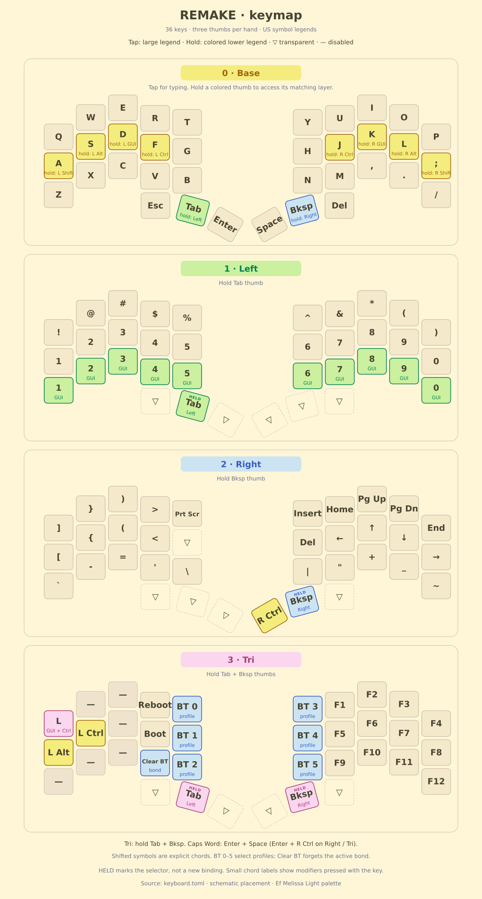

# REMAKE firmware

RMK-based firmware for Felipe Balbi's REMAKE split keyboard: 36 keys,
nice!nano v2 controllers, a BLE split link, USB/BLE host connections, and
a nice!view status screen on each half.

Hardware lives in the [REMAKE repository](https://github.com/6mil-labs/remake).
`keyboard.toml` defines the scan matrix, four layers, and key behavior;
`vial.json` exposes the 36 physical keys for remapping.

## Keymap



The base layer is QWERTY with home-row Shift/Alt/GUI/Ctrl modifiers.
Left (1) provides numbers and shortcuts, Right (2) symbols and navigation,
and Tri (3) function keys, Bluetooth controls, reboot, and bootloader access.
Holding both layer thumbs activates Tri.

Thumb keys, from left to right:

| Left third | Left layer | Left inner | Right inner | Right layer | Right third |
|---|---|---|---|---|---|
| Escape | Tab / hold Left | Enter | Space | Backspace / hold Right | Delete |
| `(3,2)` | `(3,3)` | `(3,4)` | `(3,5)` | `(3,6)` | `(3,7)` |

Escape and Delete replace Urchin's same-hand two-thumb combos and remain
available on every layer. Caps Word still uses Enter + Space, or Enter + RCtrl
on Right/Tri. Combo timeout is 50 ms.

Home-row modifiers use buffered tap/hold, 200 ms permissive hold, and
same-hand tap filtering. Thumb layer-taps use 200 ms Normal mode without
hand filtering. Flow-tap and quick-tap repeat are disabled.

## Matrix wiring

Each half has a 4 × 5 matrix with `col2row` diodes. SW1–SW5 use row 0,
SW6–SW10 row 1, and SW11–SW15 row 2. SW18/SW16/SW17 are the thumbs at
physical row 3, columns 2/3/4; columns 0/1 have no switches.

| Scan order | GPIOs |
|---|---|
| Both halves, ROW0..ROW3 | `P1_00`, `P0_11`, `P1_04`, `P1_06` |
| Left, physical COL0..COL4 | `P1_15`, `P1_13`, `P1_11`, `P0_10`, `P0_09` |
| Right, physical COL4..COL0 | `P0_09`, `P0_10`, `P1_11`, `P1_13`, `P1_15` |

The right module is flipped, and JPR jumpers remap its socket contacts.
Reversing its scan columns keeps logical columns 5..9 in typing order,
from Y to P. Socket numbers do not identify the same GPIO in both orientations.

**D18 is P1.15**, matching the working Urchin firmware and the
[nice!nano v2 vendor pinout](https://nicekeyboards.com/docs/nice-nano/pinout-schematic).
The KiCad U1 symbol and hardware assembly table's P0.15 label is incorrect;
those hardware files are not changed here.

## Build and flash

Run from this repository's root:

```sh
cargo install cargo-make             # once
cargo make test
cargo make uf2 --release
```

The existing task names produce `rmk-remake-central.uf2` and
`rmk-remake-peripheral.uf2`. Put each controller into its UF2 bootloader and
copy the matching image to its USB drive. Flash both halves after matrix changes.

Back up custom Vial mappings before resetting a stored keymap to load the new
defaults. Changes to the RMK revision or Cargo features can clear stored
settings and bonds, requiring host and split re-pairing.

## Displays and power

Each screen shows local battery level in ten segments, or `?` when unknown.
The bolt indicates local USB power, not charging. The central screen also
shows the zero-based Bluetooth profile and active layer; the peripheral
shows its split connection status.

After 30 seconds idle, the split link uses subrating and the screens clear
and switch off their external supply. On wake, screens reinitialize and
redraw current status. This is not MCU System OFF; peripheral wake can have
additional split-link latency.

USB CDC logging is disabled. To enable it temporarily, add `usb_log` to the
RMK features in `Cargo.toml` and rebuild both halves. The application caps
logs at Debug; changing features can also reset pairing data.

## Tests

Without cargo-make:

```sh
cargo test --manifest-path tests/host/Cargo.toml \
  --target "$(rustc -vV | sed -n 's/^host: //p')" --locked
```

Host checks cover display rendering, SPI recovery/cancellation, screen sleep,
5 ms debounce, representative tap/hold typing, and the resolved REMAKE matrix,
36-key layout, third-thumb actions, and remaining Caps Word combos.
Firmware and host dependencies are pinned in their respective Cargo manifests.

On hardware, check every switch on both halves, Escape/Delete on every layer,
Caps Word, Tri access, fast typing, and wake after idle. Native tests do not
validate electrical continuity, physical timing, or radio behavior.
