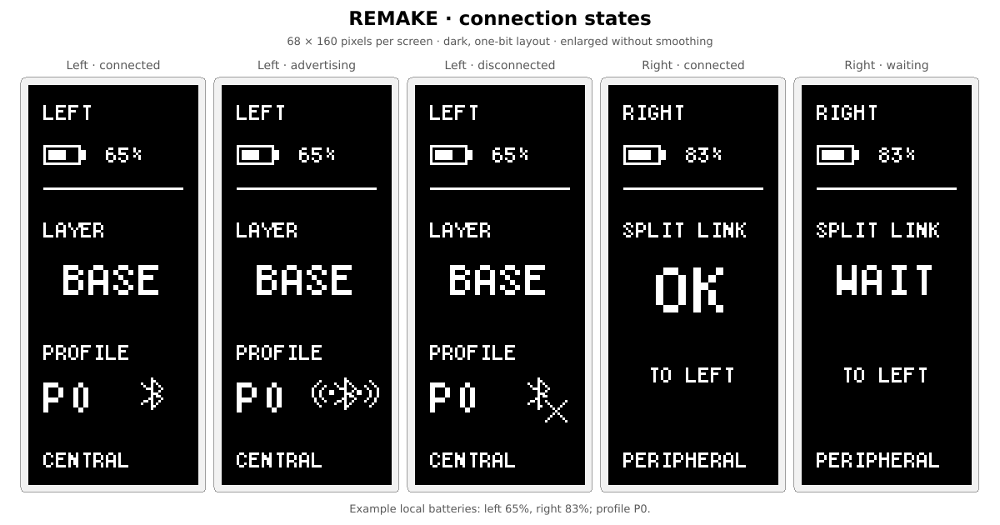
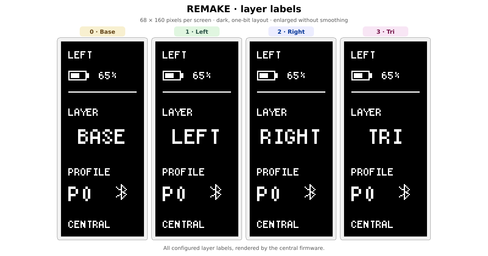

# REMAKE firmware

RMK-based firmware for Felipe Balbi's REMAKE split keyboard: 36 keys,
nice!nano v2 controllers, a BLE split link, USB/BLE host connections, and
a nice!view status screen on each half.

Hardware lives in the [REMAKE repository](https://github.com/6mil-labs/remake).
`keyboard.toml` defines the scan matrix, seven layers, and key behavior;
`vial.json` exposes the 36 physical keys for remapping.

## Keymap


[Single-page printable cheatsheet](assets/cheatsheet.svg): all seven layers and
quick reminders on **US Letter, landscape**. Print with **Fit to page** and turn
off browser headers/footers. The sheet preserves the keymap's colors and physical
positions, with larger legends and fewer repeated captions for print readability.

This experiment uses [Miryoku's layer structure](https://github.com/manna-harbour/miryoku/tree/master/docs/reference)
with the existing **QWERTY** alpha layer. A future switch to Graphite is deliberately
separate: learn the layers before changing the alphas.

Home-row mods remain Shift on A/semicolon, Alt on S/L, GUI on D/K, and Ctrl on
F/J. Sublayers put dedicated modifiers in those same positions on the supporting
hand, and single-function keys on the opposite hand. There is no Tri layer.

| Layer | Hold | Opposite-hand functions |
|---|---|---|
| Nav (1) | Left center / Enter | Clipboard, arrows, line/page movement, Caps Word |
| Mouse (2) | Left inner / Tab | Pointer, wheel, mouse buttons, clipboard |
| Media (3) | Left outer / Escape | Playback, volume, Bluetooth and USB/BLE controls |
| Num (4) | Right center / Space | Numpad and unshifted punctuation |
| Sym (5) | Right inner / Backspace | Shifted symbols in matching Num positions |
| Fun (6) | Right outer / Delete | Function keys, Print Screen, Scroll Lock, Pause, Menu |

Thumb keys, from left to right:

| Left outer | Left center | Left inner | Right inner | Right center | Right outer |
|---|---|---|---|---|---|
| Escape / hold Media | **Enter / hold Nav** | Tab / hold Mouse | Backspace / hold Sym | **Space / hold Num** | Delete / hold Fun |
| `(3,2)` | `(3,3)` | `(3,4)` | `(3,5)` | `(3,6)` | `(3,7)` |

Inner means toward the controller/center gap; outer means toward the pinkie
side (A/semicolon). Enter and Space retain their physical center-thumb positions.
Nav duplicates Backspace, Space and Delete on the right thumbs for editing and
repeat. Fun duplicates Enter and Tab on the left thumbs, with Menu on the outer
thumb. Mouse uses right/left/middle click on the right inner/center/outer thumbs.

Caps Word is on Nav's inner home-row key (base H): hold Enter and tap H.
The old thumb combos are removed so they do not compete with the six layer-taps.
Sublayer `No` keys are disabled, not transparent to the alpha layer. Bootloader
access follows Miryoku: hold any layer thumb and double-tap the top-row pinkie
on the **same hand** (Q on the left or P on the right). No single-tap reset.

Clipboard follows the supplied portable Miryoku template: Shift+Insert paste,
Ctrl+Insert copy, Shift+Delete cut, HID Undo, and raw HID Again/Redo. Application
support varies; the Again macro avoids RMK's repeat-the-last-key behavior.
Auto Shift, layer locks, extra alpha layers, bottom-row Alt mods, and unsupported
RGB controls are not included in this first experiment.

Home-row modifiers use ordered tap/hold, 200 ms permissive hold, and
same-hand tap filtering. Thumb layer-taps use 200 ms Normal mode without
hand filtering. Flow-tap and quick-tap repeat are disabled.
Ordered tap-hold is the default in the pinned head of
[RMK PR #1347](https://github.com/rmk-rs/rmk/pull/1347)
(`c3719f6f2655cacef63f3b5d12c3c830d7195828`); the former
`buffered_tap_hold` Cargo feature and TOML switch are no longer present.

### Bluetooth profiles

There are **four host profiles, BT0–BT3**, matching Miryoku, rather than the
previous six. The build-time count is `rmk.ble_profiles_num = 4` in
`keyboard.toml`; it is not a Cargo feature. `Cargo.toml` retains the existing
BLE/split features and pins the same RMK revision as the host tests.

Hold left-outer Escape for Media. The right bottom row, from inner to outer,
is **USB/BLE toggle, BT0, BT1, BT2, BT3**, matching Miryoku's positions.
The entire right top row (RGB positions) and right inner home-row key (external
power) are **unbound**: REMAKE has no RGB LEDs or general-purpose external-power
control. They are not repurposed for extra Bluetooth commands.

BT0–BT3 use User0–User3; the transport toggle is User7. RMK User IDs depend
on the profile count, so changing only the count without the keybindings is unsafe.
Holding a profile selector for five seconds invokes
RMK's clear-that-slot-and-select gesture; use a short tap for ordinary switching.
The pinned RMK revision does not implement Miryoku's Shift+profile clear or
Shift+output force-USB semantics: Shift does not change these User actions.
This is a firmware capability difference, not an extra layout binding. The
five-second clear gesture remains available without occupying an RGB key.

### Vial

Vial receives the 36-key physical matrix from `vial.json` and the seven-layer
count from firmware. Its custom-keycode slots match RMK's positional User IDs:
BT0–BT3, next profile, previous profile, clear current bond, and USB/BLE toggle.
The latter three Bluetooth commands remain available for remapping in Vial,
but are not bound to Miryoku's unused RGB positions by default.

When Vial asks you to unlock the keyboard, hold **both center thumbs**
(Enter and Space, matrix positions `(3,3)` and `(3,6)`) during its unlock prompt.
The physical-presence lock remains enabled; it is not set to insecure mode.
This is not blanket protection against a hostile USB host: the pinned upstream
handlers for raw storage reset and bootloader jump do not check the unlock gate.
Named tap/hold profiles are a firmware extension: Vial's standard layer-tap
encoding cannot represent the `THUMB` profile. Replacing a thumb binding in
Vial can therefore lose its per-key profile and inherit the global policy.

## Matrix wiring

Each half has a 4 × 5 matrix with `col2row` diodes. SW1–SW5 use row 0,
SW6–SW10 row 1, and SW11–SW15 row 2. SW18/SW16/SW17 are the thumbs at
physical row 3, columns 2/3/4; columns 0/1 have no switches.

| Scan order | GPIOs |
|---|---|
| Both halves, ROW0..ROW3 | `P1_00`, `P0_11`, `P1_04`, `P1_06` |
| Left, physical COL0..COL4 | `P1_15`, `P1_13`, `P1_11`, `P0_10`, `P0_09` |
| Right, physical COL4..COL0 | `P0_09`, `P0_10`, `P1_11`, `P1_13`, `P1_15` |

The right module is flipped, and JPR jumpers remap its socket contacts.
Reversing its scan columns keeps logical columns 5..9 in typing order,
from Y to P. Socket numbers do not identify the same GPIO in both orientations.

**D18 is P1.15**, matching the working Urchin firmware and the
[nice!nano v2 vendor pinout](https://nicekeyboards.com/docs/nice-nano/pinout-schematic).
The KiCad U1 symbol and hardware assembly table's P0.15 label is incorrect;
those hardware files are not changed here.

## Build and flash

Run from this repository's root:

```sh
cargo install cargo-make             # once
cargo make test
cargo make uf2 --release
```

The existing task names produce `rmk-remake-central.uf2` and
`rmk-remake-peripheral.uf2`. Put each controller into its UF2 bootloader and
copy the matching image to its USB drive. Flash both halves after matrix changes.

Back up custom Vial mappings before resetting a stored keymap to load the new
defaults. Changes to the RMK revision or Cargo features can clear stored
settings and bonds, requiring host and split re-pairing.
This experiment changes the RMK revision and Cargo features, invalidating the
stored configuration hash. Back up Vial mappings and expect to re-pair after
flashing. Old BT4/BT5 slots are no longer available; do not assume their stored
bonds will be preserved. Profile/layer count changes alone do **not** invalidate
that hash in the pinned revision: for a future count-only change, explicitly
reset the stored keymap if you want to load new defaults.

## Displays and power

Each screen uses a compact dark layout with a battery icon and numeric
percentage, or `?` and `--%` when unknown. The bolt indicates local USB power,
not charging. The central shows the prominent uppercase layer and a compact
zero-based profile (`P0`, `P1`, etc.). Its static host icon distinguishes connected
(plain Bluetooth symbol), advertising (small squares and short arcs on both sides),
and disconnected (an X). The peripheral shows `OK` or `WAIT` for its split link.



Pixel-accurate previews generated from the firmware renderer, enlarged for
readability. Battery values are examples, not measurements.



Status fields have fixed bounds. Ordinary changes update only affected physical
rows; startup, wake, and recovery still redraw the full screen. Unchanged content
uses hold commands at the same 16 ms panel cadence, without advertising animation.

After 30 seconds idle, the split link uses subrating and the screens clear
and switch off their external supply. On wake, screens reinitialize and
redraw current status. This is not MCU System OFF; peripheral wake can have
additional split-link latency.

USB CDC logging is disabled. To enable it temporarily, add `usb_log` to the
RMK features in `Cargo.toml` and rebuild both halves. The application caps
logs at Debug; changing features can also reset pairing data.

## Tests

Without cargo-make:

```sh
cargo test --manifest-path tests/host/Cargo.toml \
  --target "$(rustc -vV | sed -n 's/^host: //p')" --locked
```

Host checks cover display rendering, SPI recovery/cancellation, screen sleep,
5 ms debounce, representative tap/hold typing, and the resolved REMAKE matrix,
36-key layout, all six configured thumb taps/holds, repeat keys, supporting-hand
modifiers, four-profile Media bindings, and Caps Word access without thumb combos.
Firmware and host dependencies are pinned to the same RMK PR #1347 head in
their respective Cargo manifests and lockfiles. Checks also verify Vial's custom
keycode order, 36 physical positions, and reachable center-thumb unlock challenge.

On hardware, check every switch on both halves, all six thumb taps and holds,
Nav/Num chords, mouse movement/click/drag, Caps Word, guarded bootloader access,
BT0–BT3 selection, USB/BLE switching, fast typing, and wake after idle. Native tests do not
validate electrical continuity, physical timing, or radio behavior.
